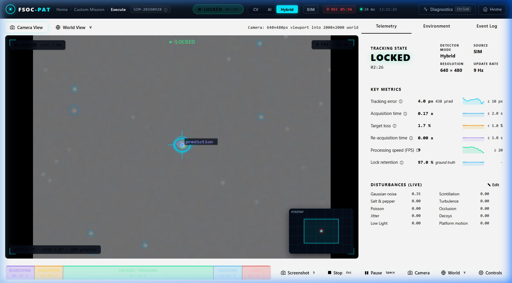
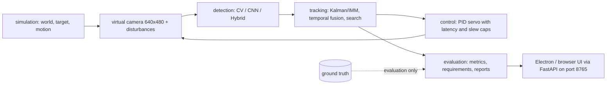

# FSOC-PAT Simulator

An AI-assisted virtual camera tracking simulator for the **coarse alignment of mobile Free Space Optical Communication (FSOC) terminals**: a simulated camera has to find a moving optical beacon, lock onto it, and keep it in view despite noise, turbulence and platform motion, while the system measures how well it did.

**Links:** [GitHub](https://github.com/shriram-s7/FSOC) · [Demo video](https://youtu.be/t4KiQGwrneo)



## Overview

Free-space optical links use very narrow beams, so before fine pointing can work, a terminal has to coarsely acquire the remote beacon and keep it inside its camera's field of view. This project, built for Smart India Hackathon problem statement **PS 26169** (ISRO / Department of Space), is a software testbed for that step: it renders a synthetic scene, runs detection, tracking and a servo loop against it, injects disturbances, and scores the run against the statement's thresholds. Ground truth is used for evaluation only, not for control (`tests/test_no_leak.py` checks this). It demonstrates *coarse alignment in simulation*, not a physical communication link.

## Features

**Mission control**
- Quick demo, custom mission (motion, speed, start position, environment, detector mode), mission brief, live execution, stop and finalise, results.
- Live camera view and world view with minimap, telemetry, environment and event log tabs, and an engineering overlay (candidate scores, accepted measurement, error vector, predicted next position).

**Detection and tracking**
- Three detector modes: **CV** (classical), **AI** (small CNN classifier) and **Hybrid**.
- Tracking state machine (searching, acquiring, locked, coasting, lost) with Kalman/IMM tracking, temporal fusion and a PID camera servo with latency and slew limits.

**Disturbances and inputs**
- Gaussian, salt-and-pepper and Poisson noise, scintillation, turbulence, occlusion, decoys, jitter, low light and platform motion, with five presets (easy to advanced).
- Video mode: upload an MP4, inspect it, optionally supply ground-truth coordinates, and analyse it.

**Camera Lab**
- A stationary world beacon with manual pan/tilt (keyboard), track-assist and auto-acquire modes. It is a 2D angular approximation, not a calibrated 3D optical bench.

**Results and comparison**
- Per-session CSV, JSON and PDF reports with data-driven PASS / FAIL / INCOMPLETE / NOT SCORED outcomes.
- Recorded **CV vs AI vs Hybrid comparison**: three synchronised replays on identical trajectories and disturbance schedules, with a comparison report.

## How it works



The camera defaults to a 4 x 3 degree field of view at 640 x 480 with 5 deg/s slew limits (`config/default.yaml`). The checks applied in reports (`evaluation/requirements.py`) are configured application checks, not an independent certification: acquisition time <= 2 s, mean pointing error <= 10 px, target loss < 5 %, re-acquisition <= 1 s, processing rate >= 20 FPS. Technical details are in [`docs/TECHNICAL_REPORT.md`](docs/TECHNICAL_REPORT.md); the demo script is in [`docs/PRESENTATION_AND_DEMO.md`](docs/PRESENTATION_AND_DEMO.md).

## Tech stack

| Layer | Technology |
|---|---|
| Simulation and vision | Python, NumPy, OpenCV, pygame (headless rendering) |
| Learning | PyTorch (beacon classifier in `models/`) |
| Tracking | filterpy (Kalman), SciPy |
| Backend | FastAPI, Uvicorn (`server/app.py`, port 8765) |
| Frontend | Plain JavaScript + HTML/CSS in Electron (no framework) |
| Reports | ReportLab, Matplotlib |
| Packaging | PyInstaller and electron-builder (`packaging/`) |

## Project structure

```text
simulation/  world, target, motion, camera, camera lab
disturbance/ noise, turbulence, scintillation and other image perturbations
detection/   CV scorer, CNN classifier, AI scanner, training scripts
tracking/    Kalman/IMM trackers, temporal fusion, search pattern
control/     PID controller and camera servo
evaluation/  metrics, logging, requirement checks, session record, PDF reports
comparison/  scenarios and isolated worker for CV/AI/Hybrid comparison
server/      FastAPI app, sessions, mission config, video preflight, comparison jobs
frontend/    Electron shell and the web UI (src/index.html, static/js, static/css)
harness/     scripted test scenarios and runner
input/       simulated and video frame sources
models/      trained beacon classifiers (.pt)
packaging/   Windows build scripts
tests/       unit tests
docs/, handoff/   technical report, demo script, implementation notes
```

## Getting started

Prerequisites: Python 3.10 to 3.13 (torch and pygame wheels were not available for 3.14 when tested) and, for the desktop shell, Node.js. A virtual environment is recommended. No secrets or API keys are needed.

**Windows (PowerShell)**

```powershell
py -3.12 -m venv venv
.\venv\Scripts\Activate.ps1
pip install -r requirements.txt
python -m server.app          # backend on http://127.0.0.1:8765
```

Then open http://localhost:8765 in a browser, or run the Electron shell:

```powershell
cd frontend
npm install
npm start
```

**Linux / macOS**

```bash
python3 -m venv venv && source venv/bin/activate
pip install -r requirements.txt
python -m server.app
```

Optional environment variables: `FSOC_PORT` (default 8765), `FSOC_LOGS_DIR`, `FSOC_VIDEOS_DIR` and `FSOC_UI_LOG_DIR` (where sessions, uploaded videos and logs are written). `requirements.txt` includes PyInstaller only for building the Windows app; Linux/macOS were not tested.

## Usage

1. Open the home page and pick **Quick Demo**, or build a **Custom Mission** and review the brief.
2. Watch acquisition in the camera and world views; toggle the engineering overlay and change the detector (CV / AI / Hybrid) or the disturbances.
3. Press **Stop**; the session is finalised and the Results page shows measurements, requirement outcomes and downloadable CSV/PDF.
4. Try **Camera Lab** for manual pointing, **Load video** for recorded footage, and **Model comparison** for the three-way replay.
5. `python main.py` still starts the older desktop dashboard (`ui/dashboard.py`); the FastAPI app above is the current interface.

## Tests

```powershell
$env:FSOC_SKIP_SLOW = "1"
python -m unittest discover -s tests
```

Observed while writing this README (Python 3.13, headless SDL): **57 tests run, all passed, 1 skipped** (the slow behavioural no-leak test; `handoff/IMPLEMENTED.md` records it passing separately). The Electron/browser flows and the full harness matrix were not re-run.

## Status and limitations

- The simulator, detection, tracking, control, session reports, Camera Lab, video mode and recorded comparison are implemented. The previous README listed only "Stage 1" as done, which was out of date.
- Comparison is a recorded replay of three separate runs, not three concurrent real-time pipelines. AI and Hybrid share one CNN; results can tie, and the report does not force a winner.
- The CNN is trained on synthetic beacons; its validation accuracy is patch accuracy, not mission accuracy.
- Not implemented or deferred: a full tracking-dynamics visualisation, real-camera validation, and a clean-machine installer test. The official PS thresholds are applied as configured checks.
- The Smart India Hackathon year is inconsistent in the repository: source headers say "SIH 2025", but the problem-statement number is in the same series as other 2026 statements. This README therefore cites only PS 26169.

## Credits

FSOC-PAT Team (author field in `frontend/package.json`). Reference: problem statement 26169, "Development of an AI-Based Virtual Camera Tracking System for Coarse Alignment of Mobile Free Space Optical Communication Terminals".

## License

No license specified (the font under `frontend/src/static/fonts/` carries its own license file).
